# Agentic ERP Exception Commander for Oracle Fusion Cloud ERP

[](https://github.com/Madhuvirat4al/agentic-erp-exception-commander-oracle-fusion)
[](https://github.com/Madhuvirat4al/agentic-erp-exception-commander-oracle-fusion)
[](https://github.com/Madhuvirat4al/agentic-erp-exception-commander-oracle-fusion)

> **GitHub Repository**: [https://github.com/Madhuvirat4al/agentic-erp-exception-commander-oracle-fusion](https://github.com/Madhuvirat4al/agentic-erp-exception-commander-oracle-fusion)

---

## 📦 Submission Deliverables (View Inline on GitHub or One-Click Download)

| Deliverable | View Inline in Browser | One-Click Direct Download | Description |
| :--- | :--- | :--- | :--- |
| 📊 **18-Slide Presentation Deck** | [**👁️ View 18 Slides Inline (PDF)**](./Agentic_ERP_Exception_Commander_Submission.pdf) | [**⬇️ Download PowerPoint (`.pptx`)**](https://github.com/Madhuvirat4al/agentic-erp-exception-commander-oracle-fusion/raw/main/Agentic_ERP_Exception_Commander_Submission.pptx) | Widescreen (`16:9`) 18-slide executive presentation deck with the GitHub repository link at the top of Slide 1 and every slide header, all 13 live application screenshots, Oracle Fusion ERP screenshots, architecture, 7 exception scenarios, and ROI metrics. |
| 🎬 **Full Narrated HD Demo Video (`2m 27s`)** | [**▶️ Watch Video Inline on GitHub**](./Agentic_ERP_Exception_Commander_Demo.mp4) | [**⬇️ Download Video (`.mp4`)**](https://github.com/Madhuvirat4al/agentic-erp-exception-commander-oracle-fusion/raw/main/Agentic_ERP_Exception_Commander_Demo.mp4) | Full-motion HD walkthrough (`< 10 MB` GitHub inline player compatible) with spoken voiceover narration, glowing spotlight frames, animated cursor tracking, click ripples, and lower-third cinema subtitles across all 9 live workflow scenes. |
| 🖼️ **High-Resolution Screenshots** | [**📂 Browse `docs/screenshots/`**](./docs/screenshots/) | — | All 16 high-resolution screenshots of the live application and Oracle Fusion Cloud ERP Payables workbench. |

---

## 🚀 Executive Summary

In large enterprises running **Oracle Fusion Cloud ERP**, Accounts Payable (AP), Procurement, and Financial Controller teams spend hours manually investigating blocked invoices across disconnected screens:
1. Checking **Invoice Headers, Lines & Holds** in Oracle Payables (`Manage Invoices`)
2. Comparing against **Purchase Orders (`PO`)** and **Goods Receipts (`GRN`)** for 3-Way Match variances
3. Verifying **Supplier Master** tax (`W-9` / `TIN`) and bank account (`IBAN`) compliance
4. Looking up corporate **Procurement & Accounting Policies** (`POL-AP-101` – `POL-FIN-501`) and **Historical Resolutions**
5. Manually identifying and emailing the responsible **Buyer, Approver, or Controller**

**Agentic ERP Exception Commander** transforms this manual triage into an **autonomous, policy-governed, human-in-the-loop command center**:
- **Synchronizes 300 Live Oracle Fusion Payables Invoices & Holds** via `/fscmRestApi/resources/11.13.18.05/invoices` and `/invoiceHolds` (`292` Open Exceptions, `10` Critical Holds, `10` Due Today, `\$6,437,388` Total Financial Exposure).
- **Autonomous Multi-Source Root-Cause Diagnosis**: Synthesizes ERP subledger lines, approval workflows, supplier master records, corporate policy guardrails, and historical precedents in milliseconds.
- **Actionable Recommendations with Confidence Score**: Provides a calibrated **Confidence Score (`92%`)**, routes to the exact **Responsible Owner**, and pre-drafts the **Buyer / Approver Communication Email**.
- **Human-in-the-Loop Governance & SOX Audit Trail**: Every action requires explicit analyst confirmation in a structured governance modal and writes an immutable entry to the **SOX-Compliant Audit Trail**.

---

## 🖥️ Visual Tour & Application Screenshots

### 1. Restricted Oracle Fusion Cloud Authentication Gate
Authenticates per-user sessions (`FIN_IMPL`) against `https://fa-esfe-dev19-saasfademo1.ds-fa.oraclepdemos.com` before loading any subledger records.
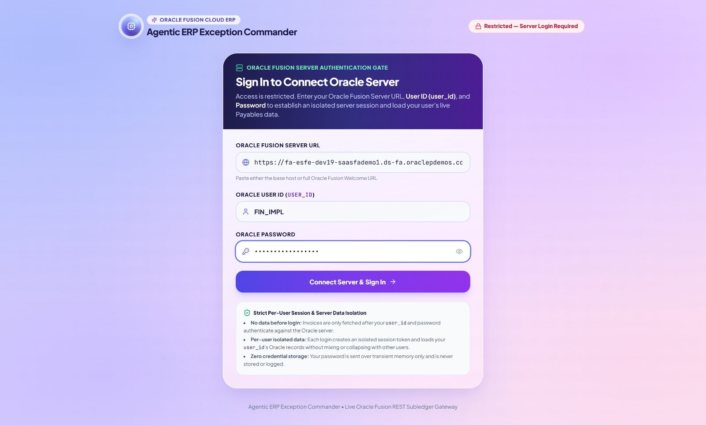

### 2. Agentic Command Center Hero & Cosmic Exposure Orb
Displays real-time financial exposure (`\$6,437,388` across `292` open holds) and spotlights Priority #1 Urgent Issue (`INV-10482 — Apex Industrial Supplies`).
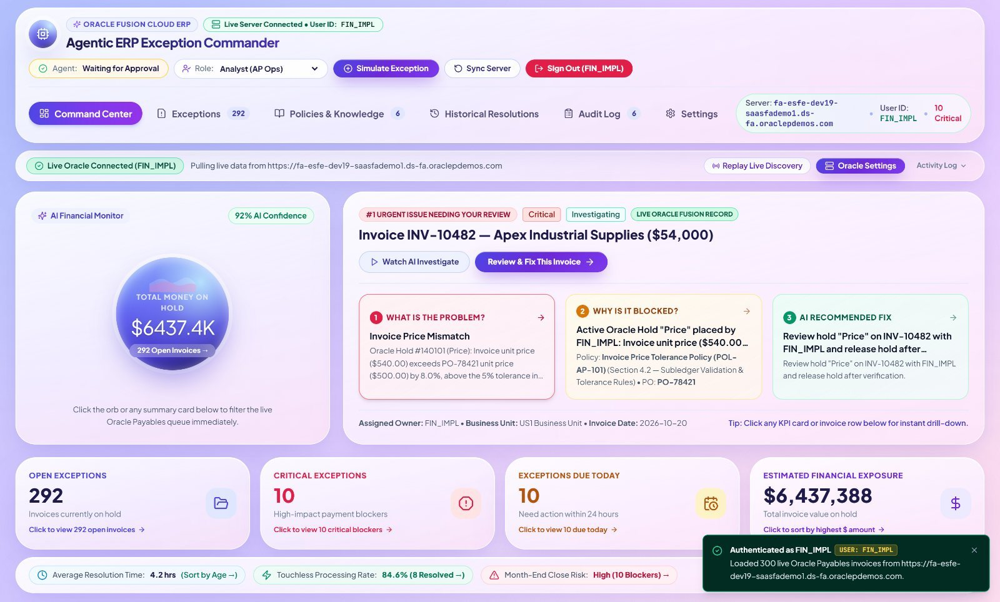

### 3. Interactive KPI Cards & One-Click Drill-Down Filtering
Clicking any KPI card (`Open Exceptions: 292`, `Critical Exceptions: 10`, `Exceptions Due Today: 10`, `Estimated Financial Exposure: \$6,437,388`) dynamically filters the 300-record Payables queue below.
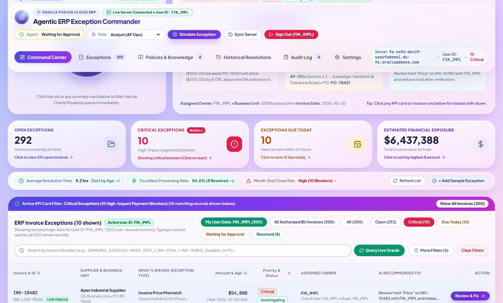

### 4. Prioritized 300-Invoice Exception Queue
Full search, category filtering, severity ranking, and AI Next-Best Action summaries across all 300 synchronized Oracle Payables invoices.
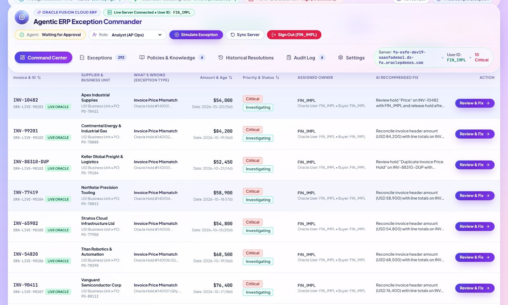

### 5. Multi-Source AI Investigation Workspace & 5-Step Comparison Pipeline
Plain-English root-cause cards (`1. What Happened`, `2. Why It Is Blocked`, `3. AI Recommended Fix`) paired with the **5-Step Subledger Comparison Pipeline** (`Invoice -> Purchase Order -> Goods Receipt -> Approval -> Resolution`).
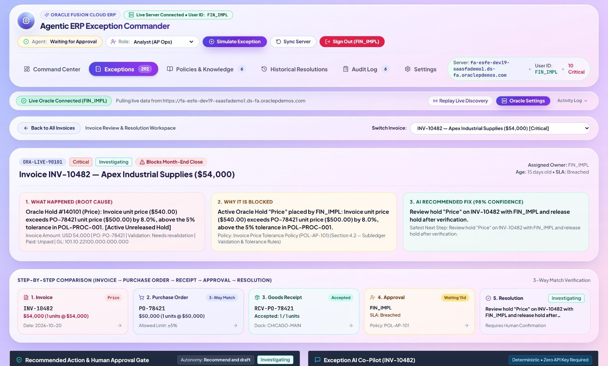

### 6. Recommended Action Panel (`92%` Confidence), Buyer Email Draft & AI Co-Pilot
Displays the policy citation (`POL-AP-101`), `92%` confidence score, auto-generated buyer email draft, 6 controlled execution actions, and the interactive **Exception AI Co-Pilot**.
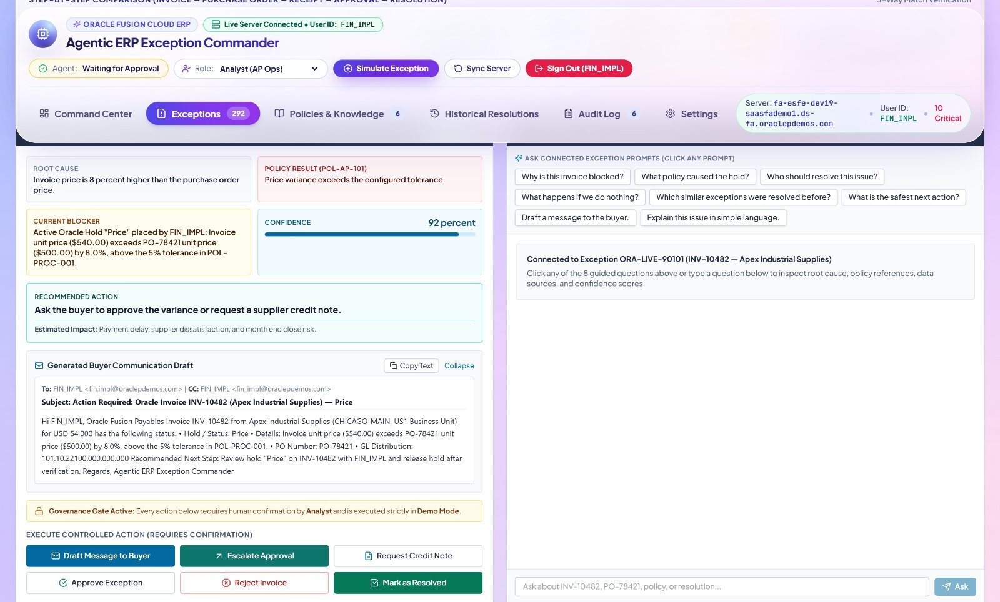

### 7. Line-Level 3-Way Match Evidence & 9-Stage Agent Telemetry
Complete subledger comparison tables and a 9-stage deterministic verification trace.
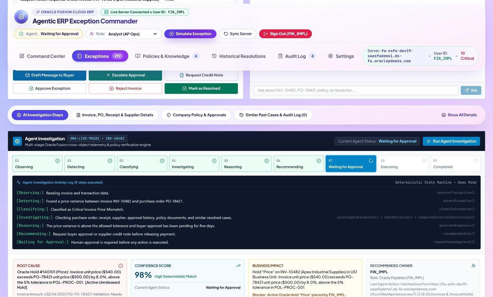

### 8. Human-in-the-Loop Action Confirmation Modal
Ensures zero unauthorized production ERP mutations—analysts review the pre-drafted message, affected records, and policy basis before clicking **Confirm & Execute**.
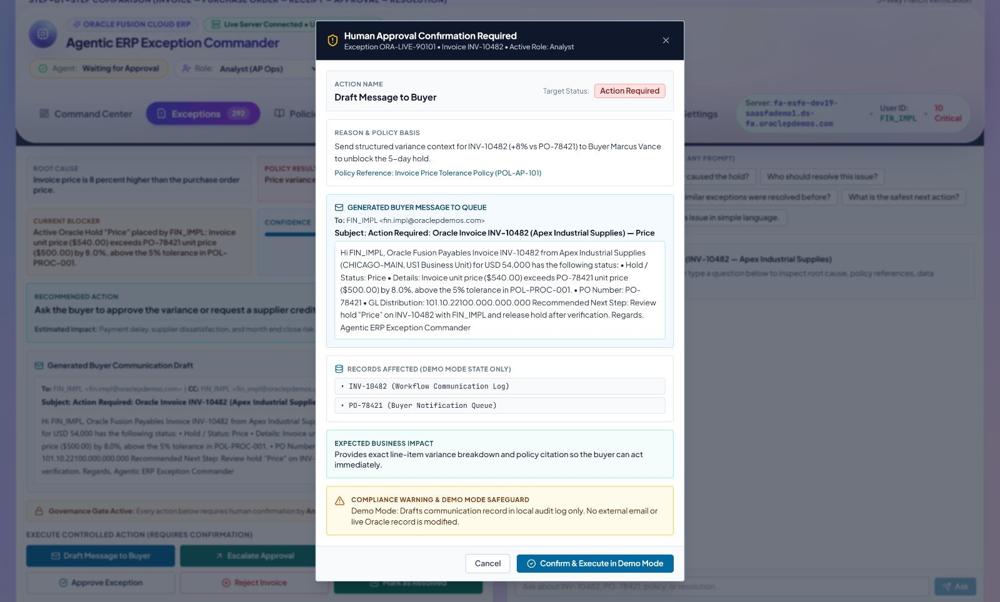

### 9. Enterprise Policy Guardrails, Historical Precedents, SOX Audit Log & Autonomy Settings
| Enterprise Policies (`POL-AP-101` – `POL-FIN-501`) | Historical Resolutions |
| :---: | :---: |
| 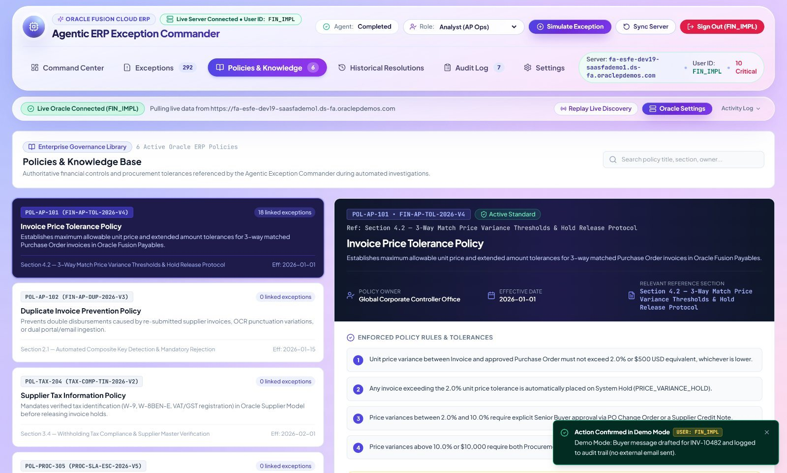 | 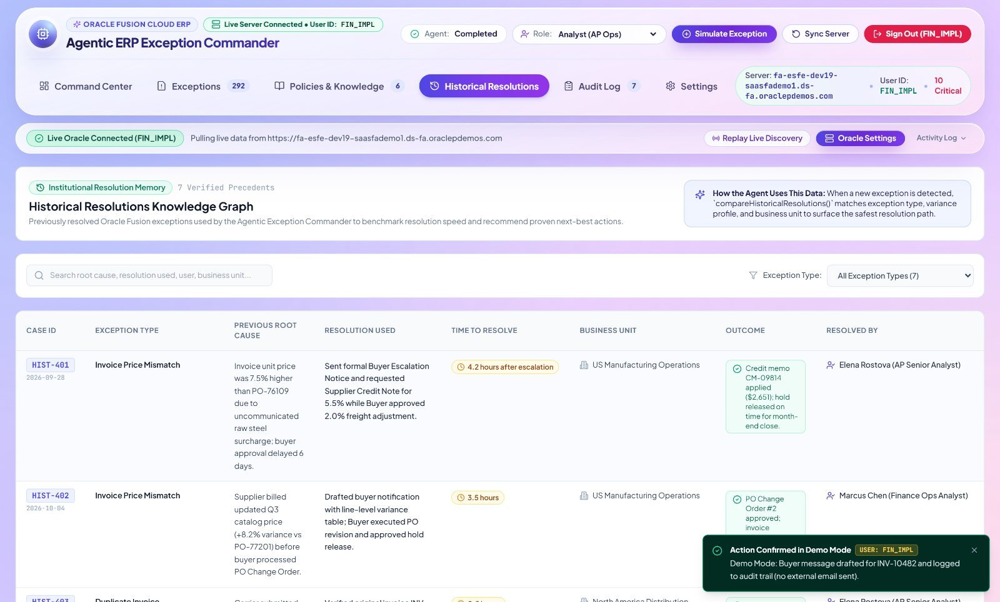 |
| **SOX-Compliant Immutable Audit Trail** | **Agent Autonomy & Oracle Gateway Settings** |
| 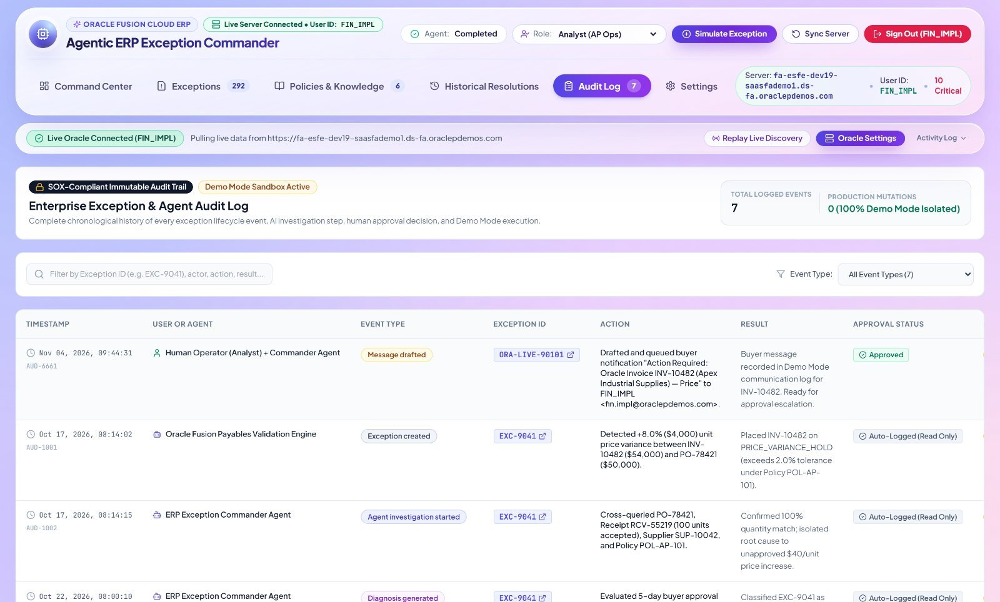 | 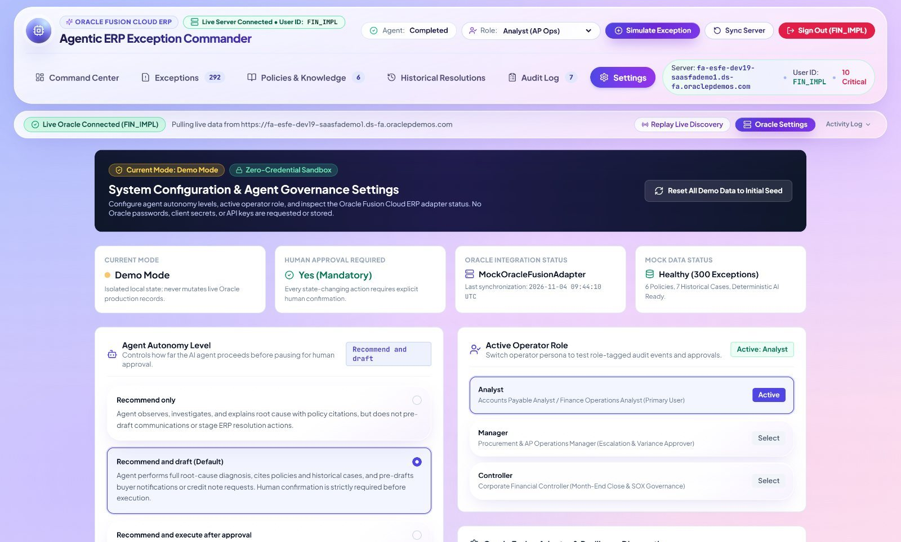 |

---

## 🏗️ System Architecture

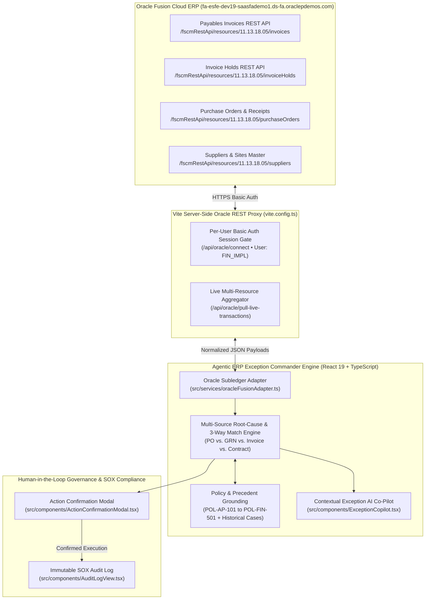

---

## 🧩 7 Supported Enterprise ERP Exception Scenarios

| # | Exception Category | Flagship Invoice | Root Cause Diagnosed by Agent | Policy Guardrail | Recommended Action & Owner |
| :-: | :--- | :--- | :--- | :--- | :--- |
| **1** | **PO 3-Way Match Price Variance** | `INV-10482` (`\$54,000`) | Unit price (`\$540`) exceeds `PO-78421` (`\$500`) by `+8.0%` (above `5%` tolerance) | `POL-AP-101` | Route to Buyer for PO Amendment or Credit Note (`92%` Confidence) |
| **2** | **Period-Close Cutoff Blocker** | `INV-99201` (`\$84,200`) | Unaccounted bulk gas line variance blocking October AP period close | `POL-FIN-501` | Accrue liability & escalate to AP Controller |
| **3** | **Duplicate Invoice Detection** | `INV-88310-DUP` (`\$52,450`) | Exact amount (`\$52,450`) and PO match previously posted `INV-88310` | `POL-AP-204` | Place permanent duplicate hold & reject invoice |
| **4** | **Supplier Tax / Bank Compliance** | `INV-77419` (`\$58,900`) | Expired `W-9` / `TIN` verification and unverified `IBAN` change request | `POL-VND-302` | Trigger Vendor Master compliance verification |
| **5** | **Approval Workflow SLA Delay** | `INV-65902` (`\$54,800`) | Department approval stalled for `7+ days` with primary approver | `POL-WF-401` | Escalate to delegate approver before discount expiry |
| **6** | **GL Account Coding Mismatch** | `INV-54820` (`\$68,500`) | Capital robotics equipment coded to OpEx Maintenance (`64200`) instead of CapEx (`15200`) | `POL-GL-108` | Reclassify GL distribution to CapEx account |
| **7** | **Quantity / Receipt Variance** | `INV-90411` (`\$76,400`) | Billed `400` wafer units vs. `360` received on `GRN-44901` (`+11.1%` variance) | `POL-AP-102` | Request warehouse receiving recount or credit memo |

---

## ⚡ Quick Start & Local Development

### Prerequisites
- **Node.js** `>= 18.x`
- **npm** `>= 9.x`

### 1. Clone the Repository
```bash
git clone https://github.com/Madhuvirat4al/agentic-erp-exception-commander-oracle-fusion.git
cd agentic-erp-exception-commander-oracle-fusion
```

### 2. Install Dependencies
```bash
npm install
```

### 3. Start the Application & Oracle Fusion Proxy Server
```bash
npm run dev
```
Open **`http://127.0.0.1:5173`** in your browser and sign in with your Oracle Fusion Cloud ERP credentials (e.g., User ID `FIN_IMPL`).
